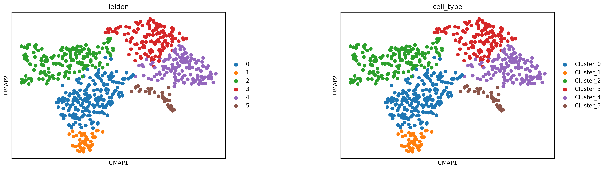
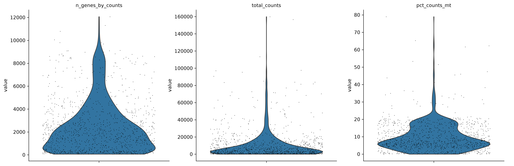
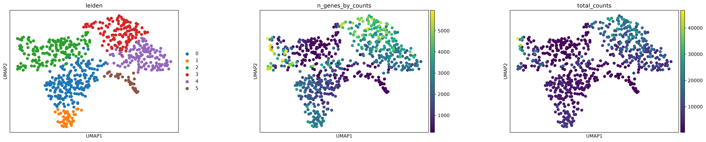

# 🧬 RNApipe — Object-Oriented Single-Cell RNA-Seq Analysis Pipeline

[](https://www.python.org/)
[](https://scanpy.readthedocs.io/)
[-8A2BE2)](#object-oriented-architecture)
[](#automated-testing)

**RNApipe** is a modular, configuration-driven, and object-oriented bioinformatics pipeline designed for end-to-end single-cell RNA sequencing (**scRNA-seq**) analysis. Built around **Scanpy** and **AnnData**, it automates quality control, normalization, dimensionality reduction, unsupervised Leiden clustering, marker-based cell type annotation, and Gene Ontology (GO) functional enrichment.

---

## 🖼️ Visual Showcase

> *All figures below are automatically generated by the pipeline in high resolution (300 DPI) without manual intervention.*

<table>
  <tr>
    <td width="50%" align="center">
      <b>1. Automated Cell Type Annotation (UMAP)</b><br/>
      
      <sub>Leiden clusters vs. automated signature-based epithelial lineage predictions.</sub>
    </td>
    <td width="50%" align="center">
      <b>2. Canonical Epithelial Markers (DotPlot)</b><br/>
      
      <sub>Expression intensity and fraction of cells expressing lineage-specific markers.</sub>
    </td>
  </tr>
  <tr>
    <td width="50%" align="center">
      <b>3. Pre-Filtering Quality Control Metrics</b><br/>
      
      <sub>Distribution of detected genes, total UMI counts, and mitochondrial transcript percentage.</sub>
    </td>
    <td width="50%" align="center">
      <b>4. Cluster Topology vs. QC Covariates</b><br/>
      
      <sub>Verification that unsupervised clusters reflect biological signal rather than technical artifacts.</sub>
    </td>
  </tr>
</table>

---

## 🏗️ Object-Oriented Architecture

Unlike monolithic procedural scripts, **RNApipe** applies software engineering best practices (*Single Responsibility Principle*, dependency injection, and abstract base contracts) so each analytical stage can be tested, extended, or executed independently.

```text
                       ┌──────────────────────────┐
                       │      PipelineConfig      │
                       │ (YAML Loader & Paths)    │
                       └────────────┬─────────────┘
                                    │ injected into
                       ┌────────────▼─────────────┐
                       │     BasePipelineStep     │  ◄── Abstract Base Class (ABC)
                       │   + run(adata) -> AnnData│
                       └────────────┬─────────────┘
                                    │ inherited by
        ┌───────────────────────────┼───────────────────────────┐
        ▼                           ▼                           ▼
┌───────────────────┐     ┌───────────────────┐     ┌───────────────────────┐
│ QualityControl    │     │ Dimensionality    │     │ CellAnnotator &       │
│ Processor         │ ──► │ Reducer           │ ──► │ FunctionalEnrichment  │
│ (QC, Norm, HVG)   │     │ (PCA, kNN, UMAP)  │     │ (Wilcoxon, GO Terms)  │
└───────────────────┘     └───────────────────┘     └───────────────────────┘
        ▲                                                       │
        └─────────────── Orchestrated in memory by ─────────────┘
